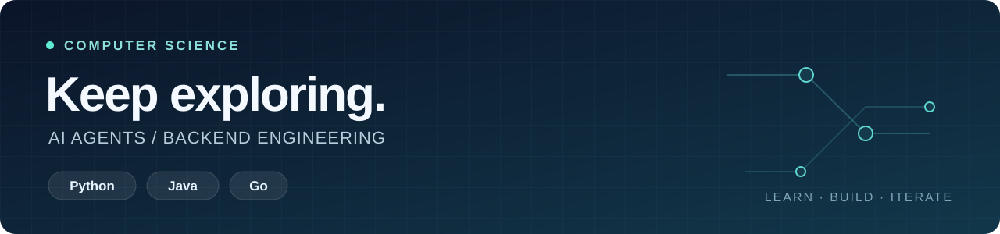

  

<h1 align="center">Hi, I'm Yue Arc 👋</h1>

  计算机硕士 · 保持好奇，持续探索 
  Master's in Computer Science · Stay curious, keep exploring

## 关于我 · About me

热衷于积极探索 **AI Agent 与后端工程**，在学习和实践中持续提升工程能力。目前正在学习 **Python、Java 和 Go**。

I hold a **master's degree in Computer Science** and enjoy exploring **AI agents and backend engineering**. I'm currently learning **Python, Java, and Go**, developing my engineering skills through study and practice.

## 探索与学习 · Exploring & learning

| | 中文 | English |
| :--- | :--- | :--- |
| 🎓 背景 · Background | 计算机硕士 | Master's in Computer Science |
| 🤖 方向 · Interests | AI Agent 与后端工程 | AI agents & backend engineering |
| 🌱 学习 · Learning | Python · Java · Go | Python · Java · Go |

---

  保持好奇 · 动手实践 · 持续进步 Stay curious · Learn by building · Keep growing

